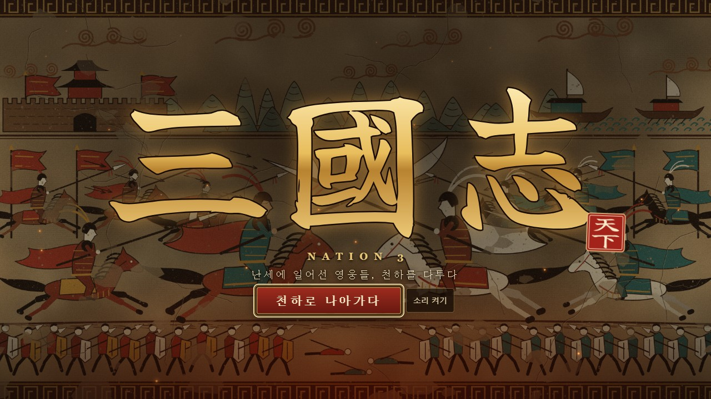
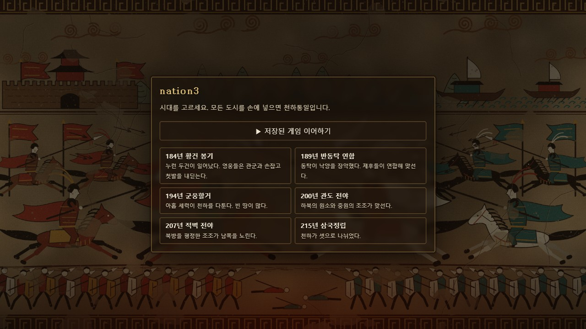
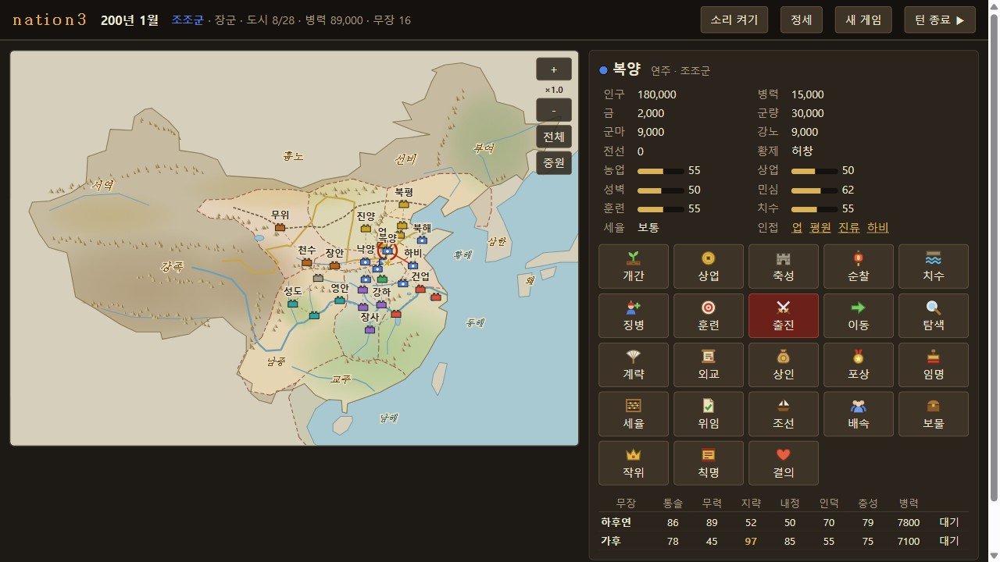
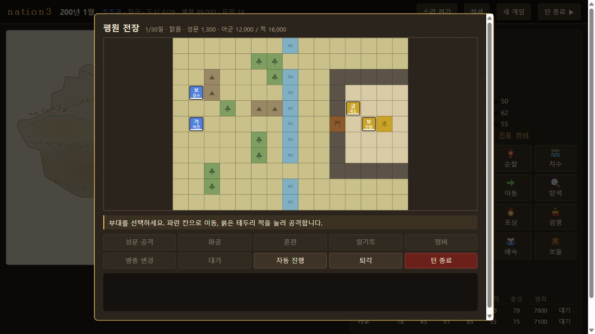

### 蒼天已死 · 天下大亂

**창천은 이미 죽었고, 천하는 어지럽다.** 
칼 한 자루로 일어설 것인가, 천자를 끼고 호령할 것인가.

## ⚔ [천하로 나아가다](https://jihunyangai.github.io/nation3/) ⚔

*설치도, 가입도 없다. 이 깃발을 누르는 순간 출진이다.* 
*PC와 휴대폰의 브라우저에서 플레이한다.*

---

## 📜 천하의 영웅들에게 고하노라

한실의 불꽃은 꺼져 가고, 13주의 들판에는 군웅의 깃발이 어지럽다.

그대는 한 세력의 군주가 되어 **달마다 나라를 다스리고, 인재를 모으고, 군사를 일으켜야** 한다.
곡식을 쌓고 성을 높이며, 이웃과 혼인을 맺었다가 때가 오면 등을 찌르라.

**28개 도시를 모두 그대의 깃발 아래 두는 날, 천하는 통일된다.**

## 🏯 천하의 형세

| 군세 | 규모 |
|:--|:--|
| 🗺 **강역** | 후한 13주, 실제 중국 지형을 따른 지도와 28개 도시 |
| 🚩 **군웅** | 조조, 유비, 손씨, 원소, 동탁, 여포 등 14개 세력 |
| 🧑‍✈️ **장수** | 시대에 따라 최대 111명, 직접 만드는 신무장까지 |
| 📯 **군령** | 내정, 군사, 외교, 인사를 아우르는 23가지 명령 |
| 🔥 **사적** | 도원결의에서 백제성의 유언까지 13가지 역사 이벤트 |
| 💎 **보물** | 명마, 명검, 병법서, 그리고 옥새까지 18종 |

## ⏳ 여섯 시대, 그대는 어디에 설 것인가

| 연도 | 시대 | 천하의 사정 | 세력 |
|:--:|:--|:--|:--:|
| **184** | 황건 봉기 | 누런 두건이 일어났다. 영웅들은 관군과 손잡고 첫발을 내딛는다. | 7 |
| **189** | 반동탁 연합 | 동탁이 낙양을 장악했다. 제후들이 연합해 맞선다. | 11 |
| **194** | 군웅할거 | 아홉 세력이 천하를 다툰다. 빈 땅이 많다. | 9 |
| **200** | 관도 전야 | 하북의 원소와 중원의 조조가 맞선다. | 7 |
| **207** | 적벽 전야 | 북방을 평정한 조조가 남쪽을 노린다. | 6 |
| **215** | 삼국정립 | 천하가 셋으로 나뉘었다. | 3 |

> **군사의 진언**: 처음이라면 빈 땅이 많은 **194년 군웅할거**를 권한다. 207년과 215년은 약소 세력에게 혹독하다.

## 🗺 군령을 내리라

| 분야 | 군령 |
|:--|:--|
| 🌾 **내정** | 개간 · 상업 · 축성 · 순찰 · 치수 · 세율 · 위임 |
| ⚔ **군사** | 징병 · 훈련 · 출진 · 이동 · 조선 · 배속 |
| 🪶 **책략과 교역** | 계략 · 외교 · 상인 · 탐색 |
| 👑 **인사와 위엄** | 포상 · 임명 · 보물 · 작위 · 칙명 · 결의 |

## 🐎 전장의 법도

출진하면 **직접 지휘**, **간이 전투**, **부장에게 맡기기** 중 하나를 고른다.

- **칸 위의 싸움**: 보병, 기병, 궁병을 움직여 지형을 이용하라. 공격군은 30일 안에 적을 무너뜨리거나 **본진을 점령**해야 한다.
- **장수의 재주**: 화공, 혼란, 그리고 장수끼리 목숨을 거는 **일기토**가 판을 뒤집는다.
- **물 위의 싸움**: 지도의 파란 길에서는 주가, 몽충, 누선으로 싸우며, 불길은 배를 타고 번진다.
- **대군의 한계**: 병력이 5,000을 넘으면 전열에 다 서지 못해 위력이 덜 늘어난다. 수만 믿지 말라.

## 🍑 의리와 천명

- **도원의 맹세**: 혈육과 의형제는 배신하지 않고, 전장에서 곁에 서면 더욱 강해진다.
- **혼인 동맹**: 우호 55 이상인 세력과 금 1,000으로 혼담을 넣어, 성사되면 5년의 동맹을 맺는다.
- **천자를 모시다**: 황제를 품은 자는 칙명으로 역적을 선포하고 정전을 명한다.
- **태수에서 황제까지**: 도시와 금을 갖추면 군주의 작위를 올릴 수 있다. 태수, 자사, 주목, 장군, 대장군, 공, 왕, 그리고 황제.
- **명장의 지휘**: 무장마다 통솔에 따른 지휘 한도가 있으니, 병사를 직접 나누어 맡겨라.

## 📖 군사의 비책

1. **첫해는 하늘이 준 시간이다.** 시작 후 12개월 동안 적은 그대를 치지 않는다. 곡식과 군사를 쌓으라.
2. **물길을 얕보지 말라.** 전선이 모자라면 수군의 힘이 떨어진다. 물 위에서 성을 치려면 수비군보다 훨씬 많은 병력을 준비하라.
3. **E 키**를 누르면 턴을 넘긴다. 전국의 형세가 궁금하면 **정세**를 펼쳐라.
4. **타이틀 화면을 누르면** 옛 가락과 전고가 울린다. 전쟁이 시작되면 버튼 소리만 남는다.
5. 진행은 **그대의 브라우저에 저장**된다. 다른 기기로는 이어지지 않으며, 브라우저 데이터를 지우면 함께 사라진다.

---

<b>🏛 사관의 기록</b> (개발 정보)

 

빌드 도구와 외부 라이브러리 없이 HTML, CSS, JavaScript로 만들었다. `nation3.html` 한 파일만 브라우저로 열어도 플레이할 수 있다.

| 파일 | 맡은 일 |
|:--|:--|
| `index.html` | 화면 구조와 스타일, GitHub Pages 진입점 |
| `map.js` | 중국 지도, 13주 경계, 확대와 이동 |
| `game.js` | 도시, 세력, 명령, AI, 월말 처리 |
| `systems.js` | 시나리오, 충성, 계략, 외교, 시작 화면 |
| `features.js` | 역사 이벤트, 보물, 작위, 수군, 혈연 |
| `battle.js` | 칸 전투와 수전 |
| `title.js` | 타이틀 애니메이션과 벽화 |
| `nation3.html` | 위 파일을 하나로 합친 단일 파일판 |

**사료에 관하여**: 역사 속 인물과 지명을 바탕으로 새로 만든 게임이다. 그림, 음악, 시나리오, 능력치는 특정 상용 게임의 자료를 쓰지 않았고, 능력치와 경계선 등은 게임을 위해 정한 근사치다.

**글꼴**: 타이틀의 붓글씨 윤곽은 [Yuji Boku](https://github.com/Kinutafontfactory/Yuji) (Copyright 2021 The Yuji Project Authors, SIL Open Font License 1.1)에서 가져왔다.

 

**分久必合, 合久必分** 
*나뉜 지 오래면 반드시 합쳐지고, 합친 지 오래면 반드시 나뉜다.*

### 🚩 [이제, 그대의 깃발을 올리라](https://jihunyangai.github.io/nation3/)

